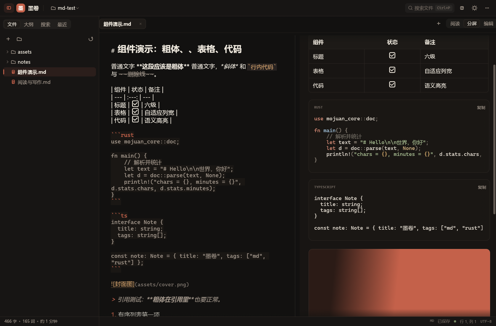
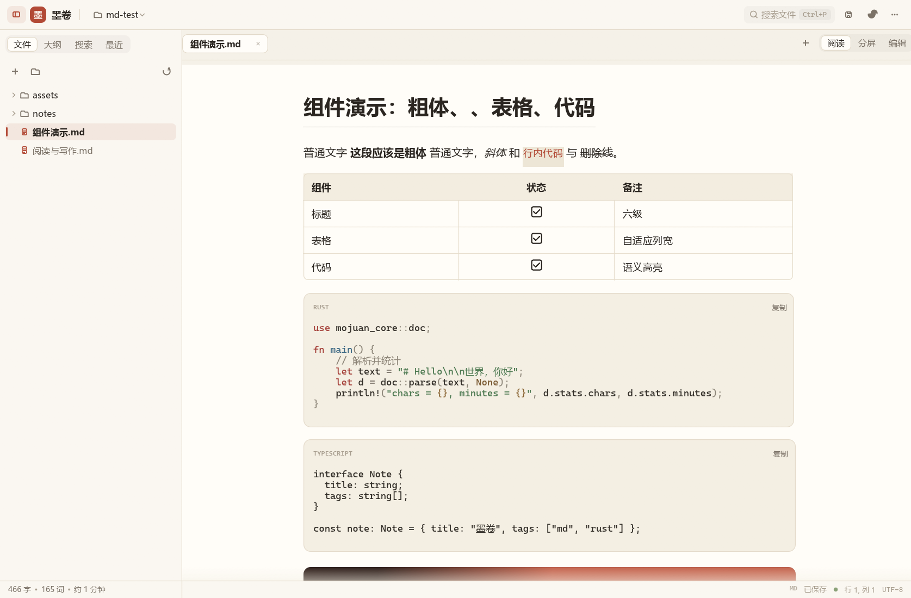

# 墨卷 · Mojuan

纯 Rust 写的 Markdown 阅读器 / 编辑器。**一个 6.2MB 的 exe，双击就能用**——不装运行时、不带 WebView2、不需要安装包。

- **原生渲染**：eframe/egui 立即模式 GUI，冷启动快、内存占用远低于 Electron/WebView 方案
- **千万字虚拟预览**：解析量只与屏幕高度成正比、与文档长度无关；1050 万字文档实测滚动流畅、峰值内存 159 MB
- **极简模式**：双击 `.md` 文件（文件关联 / 命令行传参）默认进入——无侧栏、无标签条，打开即见渲染后的内容，`Esc` 或右上角一键展开完整界面；也支持 `.txt`（纯文本直读，不按 Markdown 误渲染）
- **数学公式与流程图**：LaTeX 子集降级排版（上下标/分式/根号/矩阵），Mermaid flowchart 自绘分层（含环）；无 JS 引擎
- **阅读优先的排版**：中文字号、栏宽、行距可调；纯黑白双主题（Win11 原生风）
- **完整的编辑体验**：实时预览、分屏、源码内联着色、`Ctrl+B/I`、行复制删除（`Ctrl+D` / `Ctrl+Shift+K`）、块缩进（`Tab`）、查找替换（`Ctrl+H`）；千万字大文档用滑动窗口编辑
- **Win11 原生交互**：拖拽打开、`Ctrl+Tab` 切换标签、标签右键菜单、F11 全屏、窗口位置记忆、主题跟随系统深浅、`Ctrl+滚轮` 缩放、图片点击放大、进度条可拖跳转、外部修改自动重载
- **工作区**：打开文件夹、文件树、全文搜索、大纲跳转、最近打开、新建/重命名/删除（进回收站）
- **远程图片**：后台 WinHTTP 取回 + 纹理缓存，http/https 与 302 跳转
- **四种导出**：HTML、Word (.docx)、PDF（走系统 Microsoft Print to PDF，文字可选中可搜索）、PNG 长图；全为真排版输出（标题/表格/代码高亮/图片），零新依赖
- **自带更新**：启动时静默检查 GitHub Releases，有小浮窗提醒；一键下载后原地替换并重启

## 截图






## 直接运行

下载 `mojuan.exe`，双击即可。首次启动点「打开文件夹」，或者「更多 → 打开示例文档」看效果。

把 `.md` 文件「打开方式」设为 mojuan.exe 后，双击 md 文件就会进入**极简模式**：窗口里直接是渲染好的内容，一条细工具条，按 `Esc` 或点右上角「完整界面」回到工作区视图。`.txt` 文件同样可以直接打开（纯文本，不会被当成 Markdown 渲染）。

程序是绿色版：配置写在 exe 同目录的 `data\state.json`；如果 exe 所在目录不可写（比如放进了 Program Files），会自动改用 `%APPDATA%\Mojuan`。

## 从源码构建

需要 Rust 1.80+（开发用 1.96）。Windows 上 MSVC 和 MinGW 工具链都能编译。

```bash
cargo build --release
# 产物：target/release/mojuan.exe
```

> **注意**：如果工程放在含中文的路径下（例如 `D:\缓存\...`），MinGW 链接 proc-macro 时会报
> "cannot find ... .rcgu.o"。把编译产物指到纯 ASCII 路径即可：
> ```bash
> set CARGO_TARGET_DIR=D:\cache\mojuan-target
> cargo build --release
> ```
> MSVC 工具链没有这个问题。

依赖清单在 `Cargo.toml` / `Cargo.lock`，Windows 资源（图标、版本信息）由 `crates/app/build.rs` 在编译时嵌入。

## 快捷键

| 操作 | 快捷键 |
| --- | --- |
| 打开文件 | `Ctrl+O` |
| 打开文件夹（工作区） | `Ctrl+Shift+O` |
| 快速打开 / 命令面板 | `Ctrl+P` |
| 保存 | `Ctrl+S` |
| 新建文件 | `Ctrl+N` |
| 切换 阅读 / 分屏 / 编辑 | `Ctrl+E` |
| 加粗 / 斜体 | `Ctrl+B` / `Ctrl+I` |
| 侧栏搜索 | `Ctrl+F` |
| 关闭当前标签 | `Ctrl+W` |
| 字号增减 | `Ctrl+=` / `Ctrl+-` |
| 检查更新 | `Ctrl+U` |
| 首选项 | `Ctrl+,` |

## 检查更新是怎么工作的

1. 启动 2 秒后静默检查一次（可在首选项关闭），也可以手动「更多 → 检查更新」或 `Ctrl+U`；
2. 请求 `https://api.github.com/repos/{owner}/{repo}/releases/latest`（走系统 WinHTTP，不引入 TLS 库）；
3. 版本号比较（`0.2.0 > 0.1.0`，`jq-1.8.2` 这类带前缀的 tag 也能正确解析）；
4. 自动检查发现新版时**不弹窗**，只在右下角亮一个小浮窗「有新版本 vX.Y.Z」，
   点它才打开详情，点 × 就不再打扰；手动检查才直接弹窗；
5. 点「下载并更新」把新 exe 下到同目录的 `mojuan.update.exe`，然后在进程内完成替换：
   旧 exe 改名 `mojuan.old.exe` 让位 → 新 exe 顶上 → 拉起新进程 → 退出；
   下次启动时自动删掉 `mojuan.old.exe`。全程不写 .bat，也不碰注册表。

更新源默认读 `crates/app/src/update.rs::DEFAULT_REPO`，也可以在首选项里手填 `owner/repo`，
或用环境变量 `MOJUAN_REPO=owner/repo` 临时覆盖（方便测试）。

## 发布新版本（维护者）

```bash
# 1. 改版本号：Cargo.toml -> [workspace.package] version = "0.2.0"
git commit -am "release v0.2.0"
git tag v0.2.0
git push origin main --tags
```

GitHub Actions（`.github/workflows/build.yml`）会自动编译，并在 tag 上创建 Release、挂上 `mojuan.exe`。
程序下一次检查更新时就能看到这个版本。

## 代码结构

```
crates/
  core/                 纯逻辑，不依赖 GUI（可单独测试）
    src/doc.rs          Markdown → 结构化模型（标题/段落/代码/表格/列表/图片）
    src/highlight.rs    代码语义高亮（产出与主题无关的 token）
    src/files.rs        目录、UTF-8/GBK 读写、新建/重命名/删除（回收站）
    src/search.rs       文件名 + 全文检索 + 模糊匹配
    src/store.rs        设置、最近记录（JSON 持久化）
    src/http.rs         零依赖 HTTPS GET（WinHTTP 绑定）
    src/update.rs       Release 查询、版本比较、下载
    examples/           dump（解析结构）、net（网络）、upd（更新）三个调试工具
  app/                  egui 界面层
    src/app.rs          状态与业务动作
    src/update.rs       更新流程编排（线程、状态机、替换重启）
    src/theme.rs        调色板与样式
    src/fonts.rs        系统字体加载（雅黑/雅黑粗体/Cascadia/Emoji 兜底）
    src/icons.rs        手绘矢量图标
    src/img.rs          图片解码 + 纹理缓存
    src/art.rs          程序图标（代码生成）
    src/win.rs          DWM：让系统标题栏跟随暗色
    src/ui/             顶栏/侧栏/标签/编辑器/预览/状态栏/弹层/更新弹窗
    assets/             图标 ico + 内置示例文档
```

## 设计取舍

1. **不用 WebView**：省掉 100MB+ 的 Chromium 依赖，也不会出现"装完打不开"的运行时问题；代价是排版全靠自己画。
2. **自绘编辑器**：egui 的 `TextEdit` 负责光标/选区/IME/撤销，我们只提供 layouter 做 Markdown 内联着色。
3. **自绘表格**：先量出每个单元格的文字高度，再统一画背景、文字、行列线——这样才不会出现"高度为 0 被裁掉"的经典坑。
4. **配色**：只有黑、白两套主题，全中性灰层叠贴 Win11 原生观感（`#F3F3F3` 窗口 / 白色表面 / `#E5E5E5` 发丝线 / 系统蓝强调 `#0067C0`·`#4CC2FF`）；代码高亮取 VS Code Light/Dark 经典方案。
5. **字体**：不打包字体（省 5-10MB），读系统雅黑 + 雅黑粗体 + Cascadia Mono + Segoe UI（上下标符号兜底）+ Emoji，逐级降级；egui 内嵌字体特性也已关掉（再省 1MB 级）。egui 没有合成粗体，所以必须单独加载粗体字面。
6. **体积**：`opt-level="z"` + fat LTO + `panic="abort"` + strip；GBK 解码走系统 MultiByteToWideChar（不打包编码表）；syntect 用 onig 引擎（比 fancy-regex 省 0.65MB）；图片只嵌 png/jpeg/gif 解码。再往下要靠 UPX（可到 ~3MB），但会有杀软误报风险，默认不做。

## 体积与性能（本机 Windows 11 实测）

| 项目 | 数值 |
| --- | --- |
| 单文件 exe | **6.16 MB**（8.0 → 6.2，z 优化+fat LTO+去内嵌字体+onig 引擎）|
| 运行时依赖 | 无（不需要 WebView2 / .NET / VC++ 运行库） |
| 冷启动（普通文档） | ≈1.0 s |
| 冷启动（1050 万字，含建索引+首帧） | ≈2.9 s |
| 内存：小文档 | 114 MB WorkingSet |
| 内存：千万字文档虚拟预览 | 峰值 159 MB / 稳态 154 MB |
| 输入 → 预览刷新 | 90ms 防抖，重排通常 <30ms |

内存的大头是字体（雅黑 19.7MB + 粗体 16.9MB + Emoji 12.9MB）。
千万字文档只保存原文 + 块偏移表 + 高度数组 + 320 块解析缓存，不建整篇 AST。

## 已知限制

- 数学公式是降级排版（非 TeX 级）；复杂公式退化为源码显示，不崩
- Mermaid 只支持 flowchart/graph；sequence/class/gantt 等降级为源码块
- 大文档编辑的撤销只覆盖当前 260 行窗口
- 自动更新要求 Release 里挂了 `.exe` 资源；替换要求 exe 所在目录可写
- 图片解码只支持 png/jpeg/gif（webp 已为体积裁掉，WebP 图会显示失败状态）
- 导出 PDF 依赖系统的 Microsoft Print to PDF（Win10/11 自带）；PNG 长图仅支持 18 万字以内文档（PDF/Word 不限）；超大文档导出需等待全量排版
- 只在 Windows 11 + MinGW 实机验证；CI 产物走 MSVC 编译

## License

MIT，见 [LICENSE](LICENSE)。
